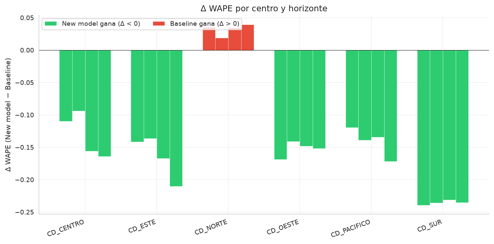

# LDS Coding Task — Demand Forecasting & Delivery Planning

## Overview

Three-part analysis of demand forecasting and delivery planning across 6 distribution centers over ~60 days: diagnostic evaluation of a baseline forecast, operational audit of the delivery plan, and a complementary zero-shot forecast model.

## Tasks

| # | Name | Description | Status |
|---|------|-------------|--------|
| 1 | Diagnóstico de Calidad y Backtesting | WAPE + Bias x centro × horizonte; chequeo de consistencia; degradación D+1→D+4 | listo |
| 2 | Estado del Plan de Entrega | Bias del plan, off-plan ratio, métricas operativas, estrategia de aplanado | listo |
| 3 | Modelo Complementario de Forecast | generacion modelo nuevo, rolling-origin backtest, calibración | listo |

## Structure

```
lds-coding-task/
├── data/
├── lds_coding_task/
│   └── evaluation/
│       └── metrics.py              # wape(), bias()
├── notebooks/
│   ├── T1_Calidad_Backtesting.ipynb
│   ├── T2_Estado_Plan_Ent.ipynb
│   └── T3_Modelo_For.ipynb
├── pyproject.toml
├── .pre-commit-config.yaml
└── README.md
```

## Environment

| Tool | Version / Notes |
|------|----------------|
| Python | 3.12.3 |
| Package manager | `uv` |
| Linter / Formatter | `ruff` / `black` |
| Pre-commit hooks | ruff → black → pytest |
| Test framework | `pytest` |

```bash
uv venv && source .venv/bin/activate
uv pip install -e ".[dev]"
pre-commit install
```

## Key Results

### Tarea 1 — Baseline Diagnostics

**Q1: Consistent under/overestimation**

| Direction | Centers | Bias range |
|-----------|---------|------------|
| Underestimation (Bias > 0) | CD_ESTE, CD_NORTE, CD_SUR | +0.06 to +0.32 |
| Overestimation (Bias < 0) | CD_CENTRO, CD_OESTE, CD_PACIFICO | −0.18 to −0.26 |

Sign is consistent across all 4 horizons for every center (no flips).

**Q2: WAPE degradation D+1 → D+4**

- 4/6 centers degrade: CD_CENTRO (+8.1 pp max), CD_PACIFICO (+5.5 pp), CD_ESTE (+3.9 pp), CD_NORTE (+3.0 pp)
- 2/6 improve slightly: CD_OESTE (−1.6 pp), CD_SUR (−1.5 pp) — volume/denominator artifact
- Global WAPE: D+1 = 0.198 → D+4 = 0.225

### Tarea 2 — Delivery Plan Audit

**Q1: Bias del plan**

- Global Bias = **+0.106** → plan subestima la demanda (~10.6% más de lo planificado)
- All 6 centers underestimate; worst: CD_ESTE (+0.141), best: CD_CENTRO (+0.082)
- Date shift: median = 0 days, mean = +0.4 days (asymmetric: 13.5% late vs. 3.9% early)

**Q2: Off-plan rate**

- Global: **17.5%** (129/739 purchases)
- Worst center: CD_NORTE (24.4%); best: CD_OESTE (10.2%)
- Worst day: Wednesday (22.9%); best: Thursday (13.9%)

**Q3: Additional operational metrics**

| Metric | Finding |
|--------|---------|
| Adhesión por cliente | 3 clients <50% adherence; Pareto effect weak (top 10% → 19% of off-plan) |
| Shift distribution | 82.5% on-time; asymmetric tail (13.5% late vs. 3.9% early) → expand forward buffer |
| Volume deviation | Mean +12.4% → problem is also demand, not just scheduling |
| Concentración | CD_NORTE × PORTAL_WEB = worst segment (29.8% off-plan rate) |
| Weekly trend | No clear degradation; oscillates 10–24% |

**Q4: Demand-flattening strategy**

- 3-layer progressive approach: nudge → incentive → hard cap
- Simulated cap at 110% of daily average: peak-to-average **1.28 → 1.10** (−14%)
- Primary KPI: peak-to-average ratio (target: <1.20)

### Tarea 3 — Complementary Forecast Model

- **Approach:** Nuevo modelo, direct multi-horizonte (D+1…D+4), 17 features (lags, rolling, peaks, calendar, plan)
- **Backtest:** Rolling-origin, min context 35 days, ~19 test days per center, ~504 total predictions
- **[EXTRA] ANÁLISIS DE INCERTEZA DE MODELOS - Calibration (regression reliability diagram):**
  - New model: well-calibrated out-of-the-box (~1 pp from diagonal)
  - Baseline + conformal PI: calibrated by construction (Vovk et al., 2005)
  - Baseline + normal PI: under-covers up to 47 pp at α = 0.9 (normality assumption violated)



*The new model outperforms the baseline in 20/24 center×horizon pairs (green = improvement, red = degradation).*

## Convenciones

- Metrics use `Σ|real|` as denominator (not `n`, not `Σ|pred|`)
- Global WAPE is volume-weighted (not mean of per-center WAPEs)
- Plots use explicit `order=` for categorical axes
- Inner joins: quantify dropped rows (%), flag if > 5%
- Backtest: strictly no lookahead (context = rows before origin *t*)
- Predictions clipped to ≥ 0
- Feature engineering: `dropna()` at end, document max lag used

## Limitaciones

- ~19 effective test days per center (Tarea 3) → wide CI on all metrics
- Nuevo modelo no se adapta a la distribución; con >500 días, entrenar una LightGBM probablemente tendría mejor performance 
- El indicador de desviación del plan aplica un criterio estricto de «el mismo día» (una variación de ±1 día se considera una desviación del plan)
- El PI conformal utiliza un único margen global (no es adaptativo por predicción).
- El modelo de referencia se evalúa en la ventana completa; el nuevo modelo, solo en la ventana de prueba (no es una comparación estrictamente equivalente).
- No hay segmentación por estacionalidad ni exclusión de valores atípicos en la Tarea 1.
- La simulación de aplanamiento de la demanda es un límite máximo (solo un tope); el efecto real del estímulo o incentivo será parcial.

## Code Availability

- Tarea 1 & 2: full notebooks in `notebooks/`
- Tarea 3: full notebook available on request (DM/PM)   
